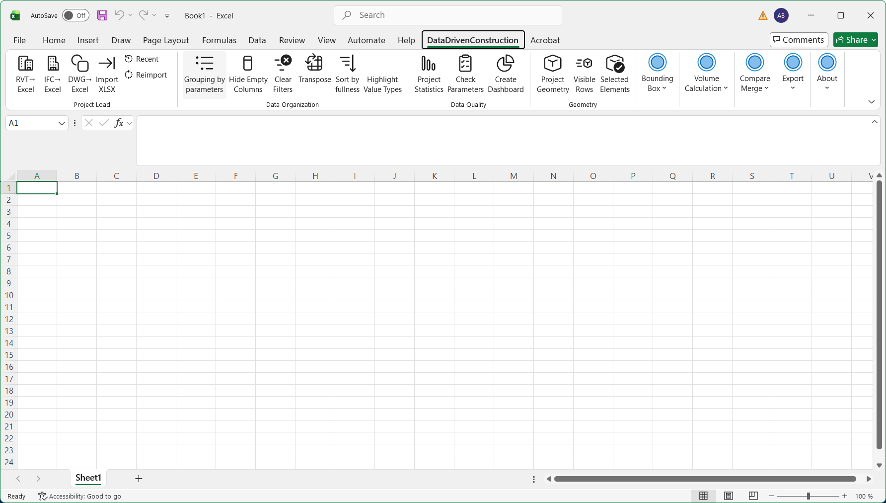
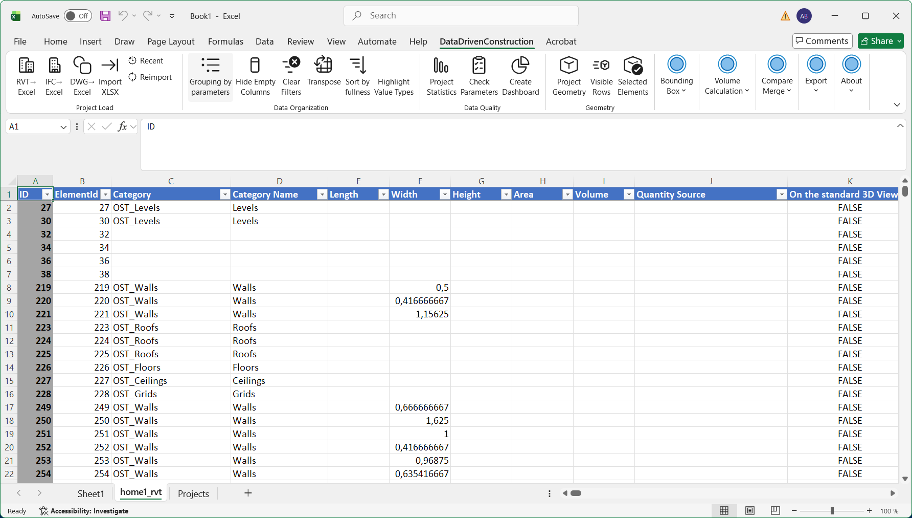
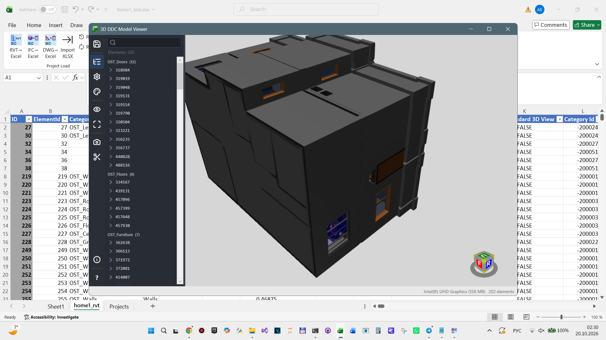

# DDC Excel add-in 2026.10.0 (preview)

Excel add-in for Windows. It imports Revit (`.rvt`, `.rfa`), IFC (`.ifc`, `.ifczip`) and DWG (`.dwg`) models into
Excel as a table with one row per element and works on that table: statistics, parameter checks, dashboards,
QTO, version comparison, JSON / XML / CSV export, 3D view of the RVT geometry.

Download: [DDC-Excel-AddIn-2026.10.0-unsigned.zip](https://github.com/datadrivenconstruction/cad2data-Revit-IFC-DWG/releases/download/v2026.10.0/DDC-Excel-AddIn-2026.10.0-unsigned.zip)
(4.3 MB, SHA-256 `148b167eacb4bd8436b60adb7d636a96fbae0af9c39bd538a6351f81072fdcb7`, also in the release's `SHA256SUMS.txt`).
This folder holds the documentation only; the package is a release asset.

## Install

1. Close Excel. Unpack the zip. Run `Install-DDC-Excel.cmd` (current user, no administrator rights).
2. Start Excel and open the **DataDrivenConstruction** tab: **RVT, IFC, DWG** import a model into a new sheet.
3. Remove it with `Uninstall-DDC-Excel.ps1`.

Requirements: Windows 10/11 x64, Excel 2016 or newer, .NET Framework 4.8.1, VSTO runtime (comes with Office).

## Converters

The package contains no converter. On the first import of a file type the add-in asks, then downloads the matching
package of this release once, checks its SHA-256 against a value fixed in the add-in, and stores it in
`%LOCALAPPDATA%\DataDrivenConstruction\Excel\converters`:

| Type | Package | Size |
|---|---|---|
| RVT, RFA | DDC RVT Converter 0.6.9 (`RVTconverter.exe --properties`) | 75 MB |
| IFC, IFCZIP | DDC IFC to Excel 0.3.1 preview | 34 MB |
| DWG | DDC DWG to Excel 0.4.1 | 22 MB |

Offline: put the official portable zip of the release into `%LOCALAPPDATA%\DataDrivenConstruction\Excel\downloads`.
The converter output (`properties.jsonl`, `native_graph.glb`, `data.jsonl`, reports) stays in a `DDC\import-*` folder
beside the model. Set the registry value `HKCU\Software\DataDrivenConstruction\Excel\ExportRevitIfc` to `1` to also
write `native_graph.ifc` (IFC4, experimental) for Revit files.

The 3D view of the RVT geometry (GLB) opens from **Project Geometry**:

## What the table contains

- **RVT**: one row per placed element: ID, ElementId, Category (OST code), Revit Class, Name, Level, Type Id, the saved
  parameters (no formulas, Revit internal units), mesh volume / area / bounding box from the GLB. Category, family and type
  names are not in the RVT table (they need the IFC export).
- **IFC**: one row per product: ID, GlobalId, Category, IfcClass, Family, Type Name, Name, Level, Length ... Volume with the
  quantity source, property sets. No geometry; quantities are the values stored in the file.
- **DWG**: one row per drawing record as written by DWG to Excel (`handle` is `ID`); the coverage columns say what was decoded.

The columns follow `ddc table` of [ddc-tools](../../ddc-tools/). Excel limits apply: 1,048,575 rows and 16,384 columns per sheet.
DGN is not supported.

## Signing

The package is **not code-signed with a public certificate** yet. VSTO manifests are signed with a self-signed test key;
the installer adds that public key to the per-user VSTO inclusion list (`HKCU\Software\Microsoft\VSTO\Security\Inclusion`)
and the uninstaller removes it. Read `SIGNING.txt` in the package, and compare the SHA-256 above before installing.

## Licence

Proprietary, under the same terms as the other DDC products: [EULA.txt](../EULA.txt) and
[LICENSE-PROPRIETARY.txt](../LICENSE-PROPRIETARY.txt) (both are also inside the package).
The add-in contains no ODA component, no other third-party CAD SDK and no Autodesk file; third-party libraries are listed in
`THIRD_PARTY_NOTICES.txt`. Autodesk and Revit are registered trademarks of Autodesk, Inc.; DataDrivenConstruction is not affiliated with Autodesk, Inc.
