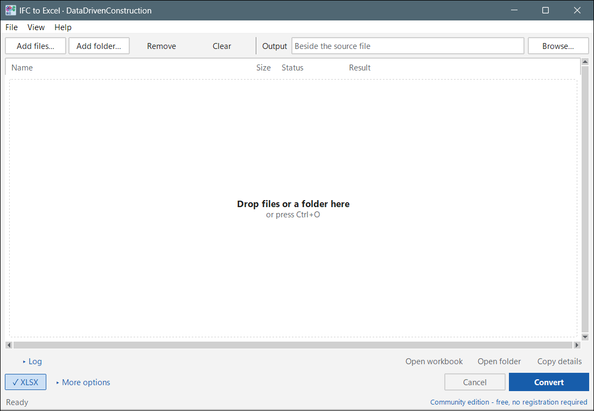
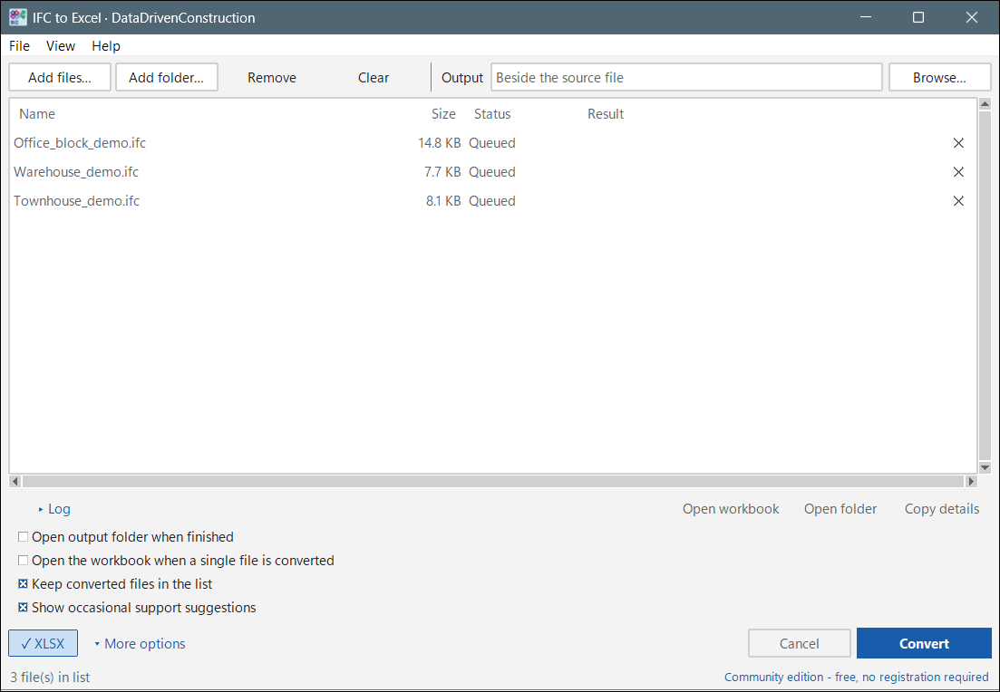
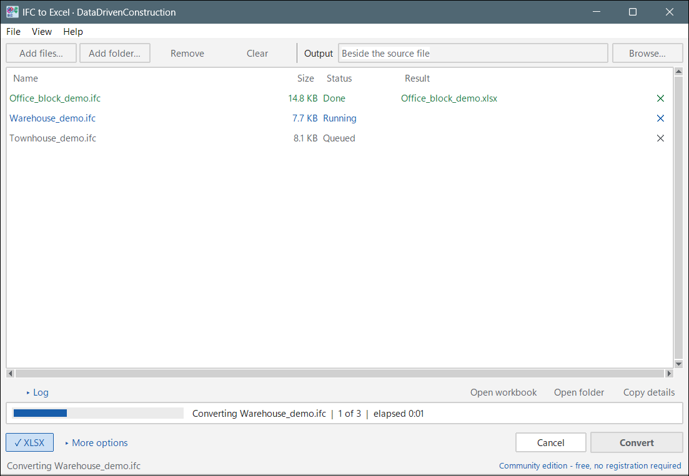
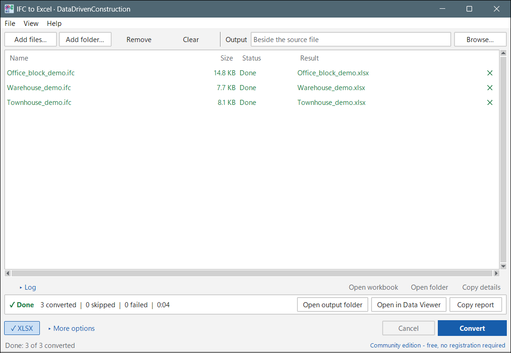
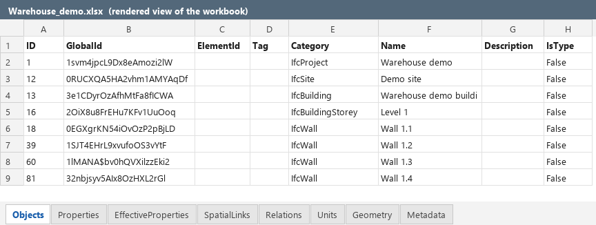
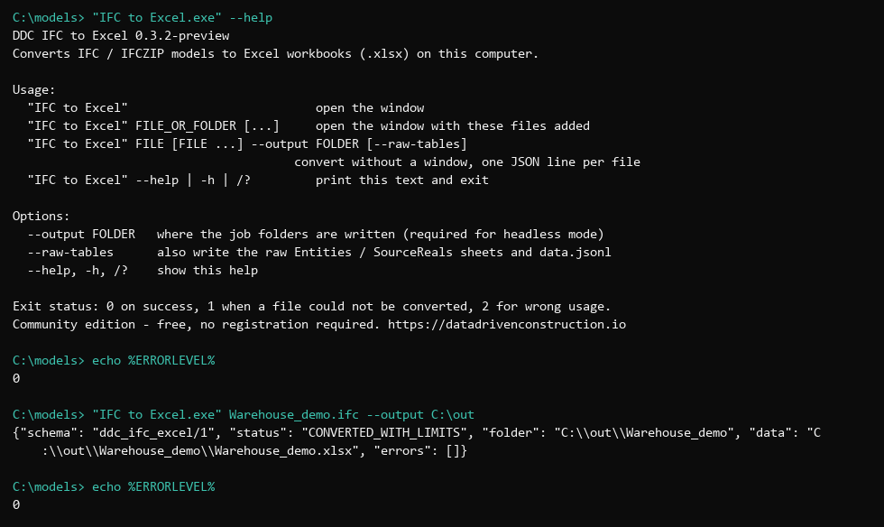

# DDC IFC to Excel

Convert IFC and IFCZIP building models to Excel workbooks (`.xlsx`) on your own computer. Nothing is uploaded, no account or licence key is needed. Windows x64, portable: unzip the folder and run `IFC to Excel.exe`. Python, Excel and CAD software are not required.

Version 2.0.0. Community edition: free for commercial and non-commercial use.



## Quick start

1. Unzip the whole folder anywhere (keep its contents together) and start **IFC to Excel.exe**.
2. Drop `.ifc` / `.ifczip` files or a folder into the window, or press **Ctrl+O** (files) / **Ctrl+Shift+A** (folder). The source files are never changed.
3. Leave **Output** empty to write next to each model (a folder `IFC to Excel` is created there), or press **Browse...** to choose another folder.
4. Press **Convert** (Enter). A strip shows `n of N`, the current file and the elapsed time; **Cancel** stops the run and removes unfinished output.
5. When it is done, use **Open output folder**, **Open in Data Viewer** (if the DDC Data Viewer is installed next to this app) or **Copy report**. Double-click a row to open its workbook.







A failed file shows a plain sentence and a **Details** link: the dialog offers **Copy details** (technical text for a bug report) and **Open log**.

## Output files

For each model `Name.ifc` the converter writes one job folder. The window groups the jobs of a run in a `session-<id>` folder (a cancelled run leaves nothing behind); the command line writes the job folder directly under `--output`:

```
window:        <output>\session-<id>\Name\Name.xlsx    + result.json
command line:  <output>\Name\Name.xlsx                 + result.json
```

`result.json` is the receipt: status, source hash, limitations, artifact hashes. With an empty Output field the window uses `<folder of the model>\IFC to Excel\`.

`Name.xlsx` contains these sheets (a sheet is omitted when the model has no such data; the order is fixed):

| Sheet | One row per | Columns |
|---|---|---|
| Objects | IFC object (project, spatial elements, products, types) | `ID` (STEP id), `GlobalId`, `ElementId` (integer tag, for linking to geometry), `Tag`, `Category` (IFC class), `Name`, `Description`, `IsType`, `Attributes` (all IFC attributes as JSON) |
| Properties | property of a property set | `owner_step_id`, `scope` (OCCURRENCE / TYPE), `relation_step_id`, `root_set_step_id`, `set_step_id`, `set_name`, `property_step_id`, `path`, `ifc_class`, `property_name`, `value` (JSON with IFC type), `unit_step_id`, `source_real_values`, `status`, `description` |
| Quantities | element quantity (`IfcQuantity*`) | same columns as Properties |
| EffectiveProperties | resolved property path per owner | `owner_step_id`, `path`, `status`, `selected_property_step_id`, `selected_scope`, `value`, `source_real_values`, `unit_step_id`, `occurrence_candidate_ids`, `type_candidate_ids`, `type_relation_ids` |
| NormalizedMeasures | length / area / volume value | exact SI text plus numeric `scale_to_si`, `si_value` columns |
| TypeLinks | object to type association | `owner_step_id`, `type_step_id`, `relation_step_id`, `scope` |
| SpatialLinks | containment / aggregation | `child_step_id`, `parent_step_id`, `relation_step_id`, `kind` |
| Relations | `IfcRel*` relationship | `step_id`, `ifc_class`, `GlobalId`, `attributes` |
| Units | unit definition | `step_id`, `ifc_class`, `attributes` |
| Geometry | element with a representation | `step_id`, `ifc_class`, `GlobalId`, `status` (DECODED or the reason), `triangles`, `bbox_min`, `bbox_max` (model units), `surface_area_model_units`, `refusals` |
| Metadata | the file | `schema`, `source_sha256`, `source_path`, `source_format`, `source_container`, `ifc_schema`, `qualification`, `limitations`, `excel_numeric_columns` |



Notes on the data:

* Values are source values. IFC `REAL` tokens are kept as text next to the numeric cell, so no precision is lost; the workbook is not a quantity take-off.
* Entities outside the built-in core table are exported generically (type name, STEP id, raw attributes `Attr1..AttrN`). No IFC schema data is shipped or loaded; there is no schema validation.
* Cells longer than Excel allows (32,767 characters) or values that cannot be stored exactly point to a `data.jsonl` / `overflow.jsonl` next to the workbook.
* `--raw-tables` (command line) adds the sheets `Entities` and `SourceReals` and the full `data.jsonl`.
* `result.json` lists the limitations that applied to each file: geometry is a tessellation subset with per-element status, and IFCXML is not supported.

## Command line

`IFC to Excel.exe --help`, `-h` and `/?` print the usage to the console and exit with code 0 without opening a window. Files can also be converted headless:

```
"IFC to Excel.exe" model.ifc --output C:\out
```

It prints one JSON line per file (`status`, `folder`, `data`) and exits with 0 on success, 1 when a file failed, 2 for wrong usage. Files without `--output` open the window with those files in the list.



## Language, theme, licence

* **View** menu: language (15 languages, follows Windows by default) and theme (follows Windows, or light / dark). Both are remembered.
* **Help > Licence...**: Community edition, free, no key. An optional registration with your e-mail is stored only on this computer in `%APPDATA%\DataDrivenConstruction\registration.json` (shared by the DDC apps; nothing is sent) and can be changed or reset there.
* **Help > Feedback...**: send a message (category, text, name, e-mail, explicit consent; only app version, Windows version and language are attached, never files or paths). Offline messages stay on this PC and are offered again at the next start. **Help > Support the project...** lists GitHub star and share links; an occasional card after several successful conversions can be switched off under More options.
* **Help > About**: version, build, edition and trademark notice. **Help > Licence texts** opens the `licenses` folder.
* Logs: **Help > Logs folder**.

## Limits

Geometry, computed properties and completeness of source data are not qualified; IFCXML is not supported. The receipt `result.json` shows what applied to each file.

## Licences

Licence texts for the bundled runtime and components are in the `licenses` folder and `runtime/LICENSE.txt`.

Autodesk, AutoCAD, DWG and Revit are trademarks of Autodesk, Inc.; IFC and buildingSMART are trademarks of buildingSMART International Ltd.; Microsoft, Excel and Windows are trademarks of Microsoft Corporation. They are used only to describe file-format interoperability. This product is not affiliated with, endorsed or sponsored by these companies.

Publisher: Data Driven Construction - https://datadrivenconstruction.io
