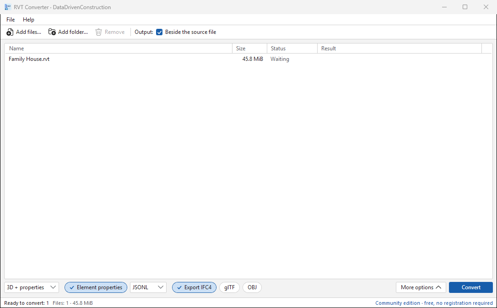

# DDC RVT Converter 2.0 for Windows

Open the data inside Revit models without Revit: get a spreadsheet of every element, a 3D model and,
if you need it, an IFC file. Made for estimators, BIM managers, analysts and anyone who receives `.rvt` files
and wants to count, check or reuse what is inside them.


*A Revit model in the list; the buttons at the bottom choose what to write: properties, IFC4, glTF, OBJ.*

## What you get

For every model, the app creates a folder next to it (for example `Family House.converted`) with:

| File | What it is | Open it with |
|---|---|---|
| `elements.xlsx` | A spreadsheet of every element: category, family, type, level, length, area, volume and parameters | Excel, LibreOffice, Power BI, Python |
| 3D model (`.glb`) | A lightweight 3D model; each part keeps the element id of the row in the spreadsheet | DDC Data Viewer, Windows 3D Viewer, any web viewer |
| IFC file (`.ifc`), when *Export IFC4* is on | The model in the open IFC format for other BIM programs | Solibri, BIMcollab, Navisworks, Archicad, BlenderBIM and others |
| Properties (`.jsonl`), when *Element properties* is on | All saved parameters of every element, for scripts and databases | Python, n8n, any JSON tool |

## Supported Revit versions

| Revit version the file was saved in | Supported |
|---|---|
| 2019, 2020, 2021, 2022, 2023, 2024, 2025, 2026, 2027 | Yes |
| `.rvt` projects and `.rfa` families | Yes |
| Older than 2019 | No — open and save the file in a newer Revit first |

## Getting started

1. **Download.** Get `DDC-RVT-Converter-…-portable.zip` (or the installer) from the
   [Releases page](https://github.com/datadrivenconstruction/cad2data-Revit-IFC-DWG/releases) and unzip it to any folder,
   for example `C:\DDC\RVT-Converter\`. Nothing else needs to be installed.
2. **Add your models.** Start `RVT Converter.exe`, then drag `.rvt` or `.rfa` files (or a whole folder) into the window,
   or use **Add files…**.
3. **Choose the outputs.** Switch on *Element properties* for all parameters and *Export IFC4* for an IFC file;
   glTF and OBJ are there if your 3D tool needs them.
4. **Press Convert** and wait until the status says *Written*.

   
   *Done: the result folder is shown under Result; **Open output** in the status bar opens it.*

5. **Open the result** in Excel, or open `elements.xlsx` in the free DDC Data Viewer to see the table and the 3D model together.

   
   *The element table of a two-storey house: 189 elements by category, family, type and level, with totals on the right.*

   
   *Filter the table — here by Windows — and the matching elements light up in 3D.*

## Command line

For batch jobs and scripts, use `cli\RVTconverter.exe` from the same folder:

```bat
:: 3D model and reports into "Family House.converted" next to the file
cli\RVTconverter.exe "C:\Projects\House\Family House.rvt"

:: choose the output folder and also write all properties and an IFC file
cli\RVTconverter.exe "C:\Projects\House\Family House.rvt" -o "C:\Projects\House\Export" --properties --ifc
```

`cli\RVTconverter.exe --help` lists every option. The program returns 0 when everything was written,
2 when the result was written with notes in the report, and 1 when it failed.

## Frequently asked questions

**Do I need Revit or an Autodesk account?** No. The app reads the files itself.

**Which Revit versions are supported?** Files saved in Revit 2019 to 2027.

**Is it free?** Yes, for non-commercial use: learning, research, teaching and personal projects.
Using it in paid work, for clients, or inside a company product needs a commercial licence —
write to [info@datadrivenconstruction.io](mailto:info@datadrivenconstruction.io). Full terms: [EULA](../../EULA.md).

**Which Windows?** Windows 10 or 11, 64-bit. The portable version runs from any folder, even a USB stick.

**Are my files uploaded anywhere?** No. Everything happens on your computer; models never leave it,
and the app works without an internet connection.

**I only need IFC.** Then [DDC RVT to IFC](../DDC_RVT_to_IFC/) is the simpler choice: it has the IFC settings up front.

**How do I update?** Download the new zip from [Releases](https://github.com/datadrivenconstruction/cad2data-Revit-IFC-DWG/releases)
and replace the contents of the folder. Keep the whole folder together: the app needs the `cli` folder next to it.

## Help and feedback

- Questions, ideas or a file that does not convert: [open an issue](https://github.com/datadrivenconstruction/cad2data-Revit-IFC-DWG/issues)
  or use **Help → Feedback…** in the app.
- Commercial licences and projects: [info@datadrivenconstruction.io](mailto:info@datadrivenconstruction.io)
- Website: [datadrivenconstruction.io](https://datadrivenconstruction.io)

---

<sub>Screenshots: the house model is `home1.rvt` (MIT licence); *Openings Study* is `revit-openings_v22.rvt` from McNeel's
Rhino.Inside.Revit samples (MIT licence). Autodesk® and Revit® are trademarks of Autodesk, Inc. DDC is not affiliated with,
endorsed by or certified by Autodesk. File-format names (RVT, RFA, IFC) identify file formats only.</sub>
