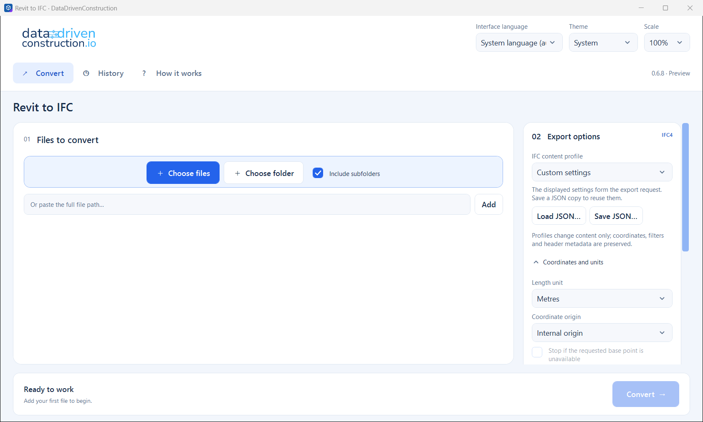
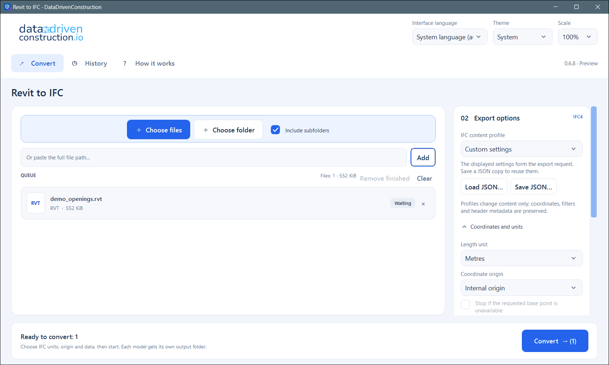
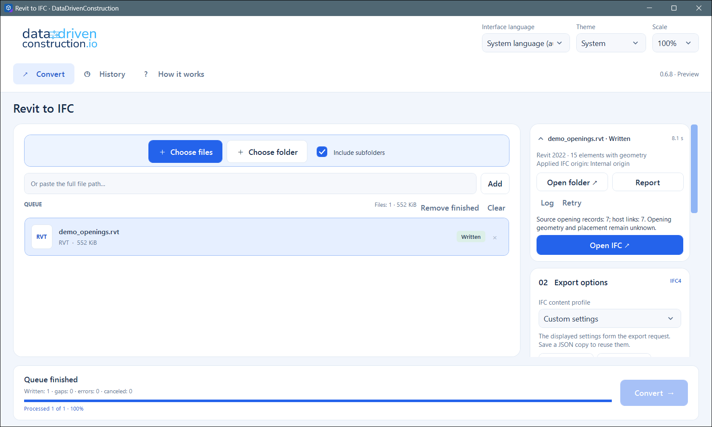
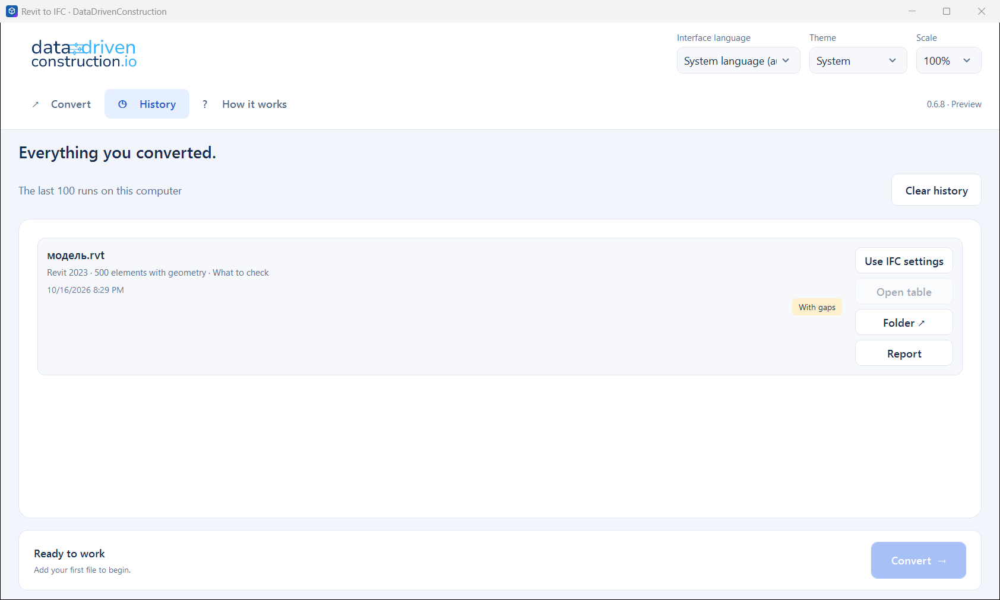
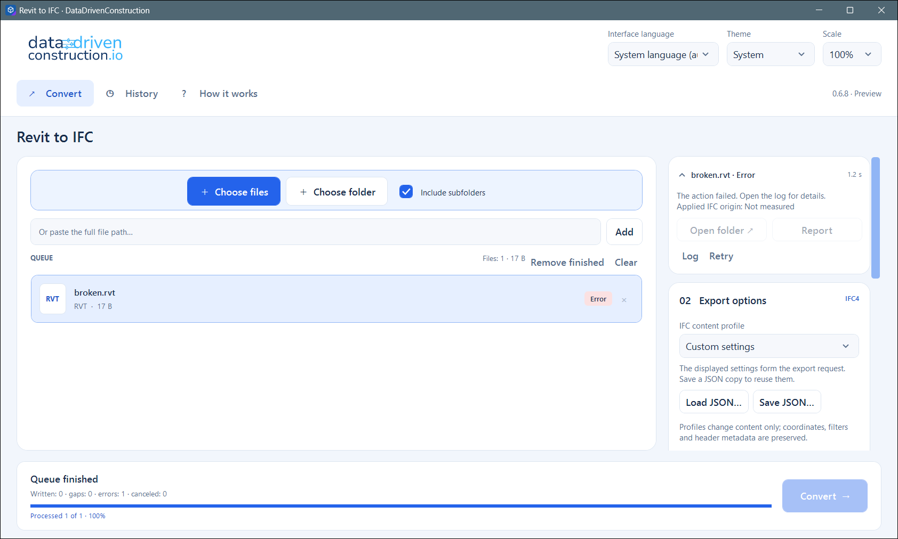

# DDC RVT to IFC (portable, Windows x64)

Reads `.rvt` / `.rfa` files saved by Autodesk® Revit® and writes IFC export through the desktop app; the CLI is the same engine as in DDC RVT Converter.
Preview quality: always check `report.json` and `summary.json` next to the result.
The exact version is in `MANIFEST.json` in this folder. Licence: `EULA.txt`.

> Screenshots show version 0.6.8. They will be updated with 0.6.9. Example model: a small open sample (McNeel Rhino.Inside.Revit "openings" sample, saved with Revit 2022); no Autodesk sample models are used.
>
> Sample model: rhino.inside-revit revit-openings_v22.rvt, MIT License, (c) 2019 Robert McNeel & Associates, https://github.com/mcneel/rhino.inside-revit

## Quick start

1. Open `Revit to IFC.exe` (no installation; keep the whole folder together).
2. Drop `.rvt` / `.rfa` files or a folder on the window, or use **Choose files** / **Choose folder** (Ctrl+O).
3. Choose the IFC content profile, units and origin (the options are on the right; every setting can be saved as JSON). Results go beside the source file unless you choose a folder.
4. Press **Convert**. The bar at the bottom shows the current file and progress; **Stop** cancels.
5. Press **Open IFC** / **Open folder** when the file is marked *Written*. Check `report.json` and `summary.json` (see Output files).

| Start | File chosen | Progress |
|---|---|---|
|  |  |  |

| Summary |
|---|
|  |

| History | An error is shown in the queue row |
|---|---|
|  |  |

Licence: Community edition, free, no registration required (0.6.9 adds an optional registration in Help > Licence).

## Output files

Every model gets its own folder `<name>.ifc-converted` beside the source (or in the folder you chose). Example from the sample model:

| File | What it is |
|---|---|
| `native_graph.ifc` | The IFC4 model. `ifc.settings.json` and `ifc.manifest.json` record the settings used and the written entities. |
| `native_graph.glb` | The geometry the IFC was built from. |
| `summary.json` | Counts and status of the run. |
| `report.json`, `conversion-report.html` | Per-element diagnostics; read these before trusting a result. |

Example views of the IFC in a viewer will be added with the 0.6.9 screenshots.

CLI example (real output for the sample model):

```
> cli\RVTconverter.exe "Project.rvt" -o "Out\Project" --ifc
WRITTEN_QUALITY_UNVERIFIED | saved Revit 2022 | 2.155 s
Active elements: 2474 | mesh elements: 15 | triangles: 1376 | category IDs: 102
Omission counters: 0 | refused records: 0 | elements with issues: 0
Model: Out\Project
ative_graph.glb
IFC4 model: Out\Project
ative_graph.ifc | IFC_WRITTEN_SCHEMA_UNVALIDATED
Geometry completeness/quality is unverified.
```

## Layout

```
DDC_RVT_to_IFC\
  Revit to IFC.exe              desktop app
  cli\RVTconverter.exe          command line (use this from scripts, n8n, notebooks)
  MANIFEST.json, licenses\, EULA.txt, README.html
```

Keep the whole folder together. Installer and zip of every version: [Releases](https://github.com/datadrivenconstruction/cad2data-Revit-IFC-DWG/releases).

## Command line

```bat
:: model -> GLB + summary.json + report.json in <name>.converted beside the input
cli\RVTconverter.exe "C:\Models\Project.rvt"

:: choose the output folder (it must not exist yet) and also write IFC4
cli\RVTconverter.exe "C:\Models\Project.rvt" -o "C:\Out\Project" --ifc

:: property table (properties.jsonl), glTF, OBJ
cli\RVTconverter.exe "C:\Models\Project.rvt" -o "C:\Out\Project2" --properties --gltf --obj
```

`cli\RVTconverter.exe --help` lists all options (IFC profiles, units, origin, category and phase filters).
Exit codes: 0 written, 2 written with reported gaps or invalid arguments, 1 failure.

## Migrating from the retired 18.x `RvtExporter.exe`

- Same call shape: `converter "model.rvt"`. Point your script to `cli\RVTconverter.exe`.
- Different output: a folder `<name>.converted` (GLB, JSON, optional `properties.jsonl`) instead of
  `<name>_rvt.xlsx` + `<name>_rvt.dae`. The old positional output arguments and `bbox` / `complete` /
  `sheets` style switches do not exist. The old flat table is rebuilt by `ddc convert` / `ddc table` (folder `ddc-tools` of this repository); the 3D model is the GLB.

## Updating

This folder is replaced as a whole by a newer release: delete the folder contents except this
`README.md`, then copy the contents of the new portable zip into it.

Autodesk® and Revit® are trademarks of Autodesk, Inc. DDC is not affiliated with, endorsed by or certified by Autodesk. File-format names (RVT, RFA, DWG, DXF) identify file formats only.
