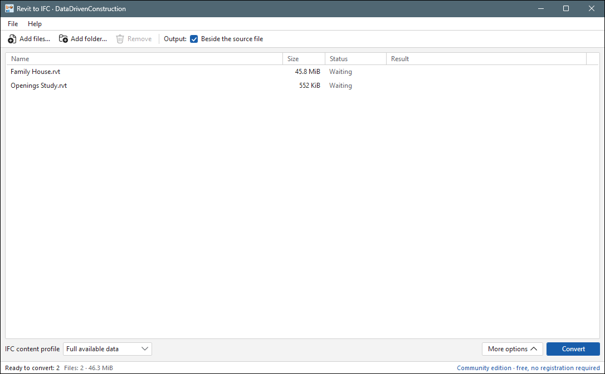

# DDC RVT to IFC 2.0 (portable, Windows x64)



Reads `.rvt` / `.rfa` files saved by Autodesk® Revit® and writes IFC export through the desktop app; the command line is the same as in DDC RVT Converter.
Each run writes `report.json` and `summary.json` next to the result: they list what was read and what was skipped.
The exact version is in `MANIFEST.json` in this folder. Licence: `EULA.txt`.

> **Licence: free for non-commercial use only.** Commercial use of the DDC converters requires a licence on
> request: [info@datadrivenconstruction.io](mailto:info@datadrivenconstruction.io). Commercial use means use by or
> for a business or organisation, in paid work or services (including processing files for clients), in
> revenue-generating projects, or inside a product, service or SaaS offered to others. Personal learning,
> research, teaching and non-profit evaluation are non-commercial. Terms: [EULA](../../EULA.md) and
> [LICENSE-PROPRIETARY](../../LICENSE-PROPRIETARY). The MIT-licensed `ddc-tools` and the documentation are a separate, open-source licence.

## Layout

```
DDC_RVT_to_IFC\
  Revit to IFC.exe              desktop app
  cli\RVTconverter.exe          command line (use this from scripts, n8n, notebooks)
  MANIFEST.json, licenses\, EULA.txt, README.html
```

Keep the whole folder together. Installer and zip of every version: [Releases](https://github.com/datadrivenconstruction/cad2data-Revit-IFC-DWG/releases).

## Command line

```bat
:: model -> GLB + summary.json + report.json in <name>.converted beside the input
cli\RVTconverter.exe "C:\Models\Project.rvt"

:: choose the output folder (it must not exist yet) and also write IFC4
cli\RVTconverter.exe "C:\Models\Project.rvt" -o "C:\Out\Project" --ifc

:: property table (properties.jsonl), glTF, OBJ
cli\RVTconverter.exe "C:\Models\Project.rvt" -o "C:\Out\Project2" --properties --gltf --obj
```

`cli\RVTconverter.exe --help` lists all options (IFC profiles, units, origin, category and phase filters).
Exit codes: 0 written, 2 written with reported gaps or invalid arguments, 1 failure.

## Flat table for scripts

The output is a folder `<name>.converted` (GLB, JSON, optional `properties.jsonl`). A flat table (`<name>_rvt.xlsx`, sheet `Project_Data`) is built by `ddc convert` / `ddc table` (folder `ddc-tools` of this repository); the 3D model is the GLB.

## Updating

This folder is replaced as a whole by a newer release: delete the folder contents except this
`README.md`, then copy the contents of the new portable zip into it.

Autodesk® and Revit® are trademarks of Autodesk, Inc. DDC is not affiliated with, endorsed by or certified by Autodesk. File-format names (RVT, RFA, DWG, DXF) identify file formats only.
