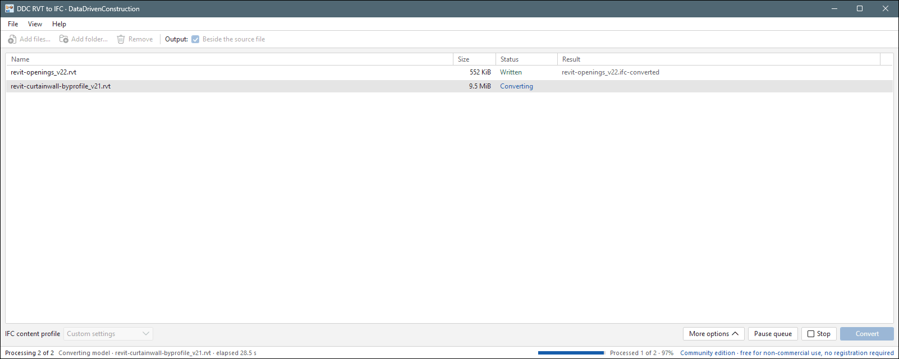
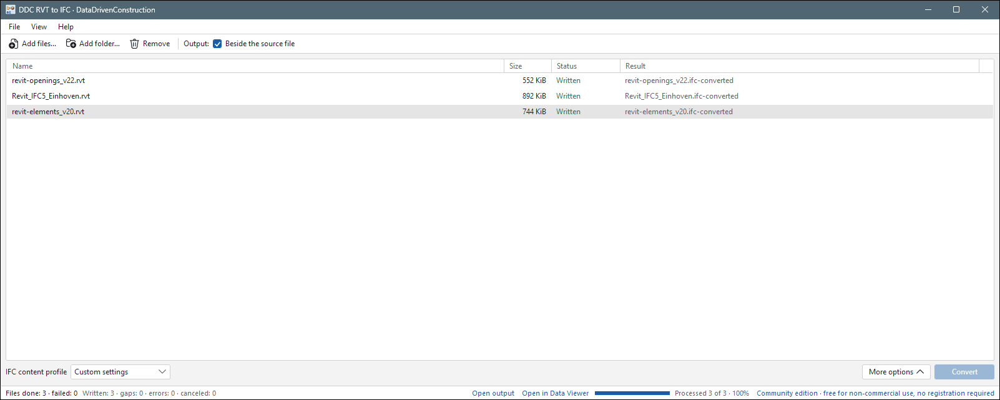
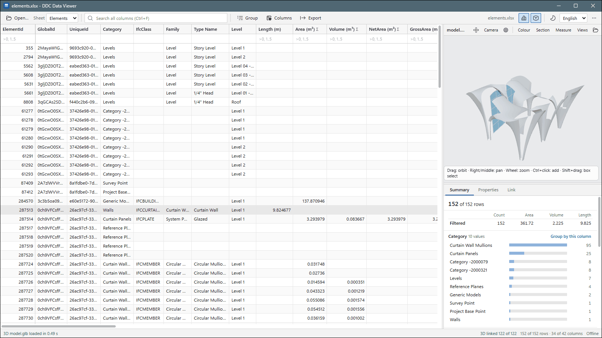
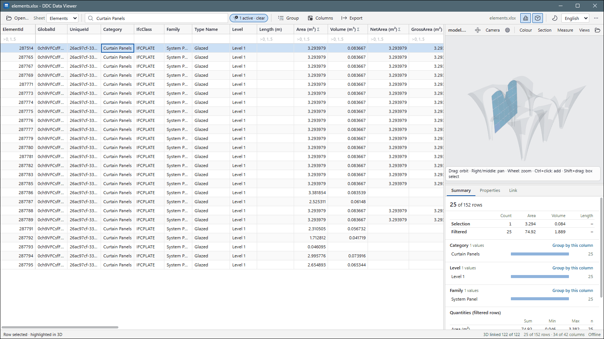
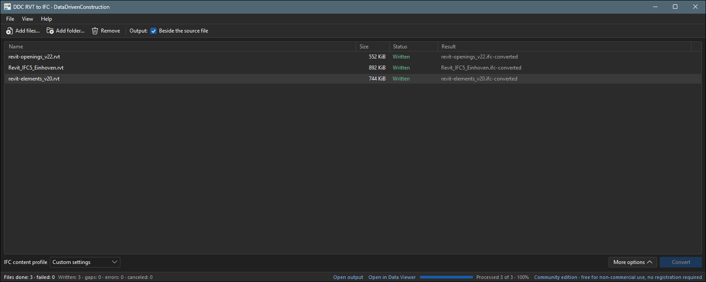
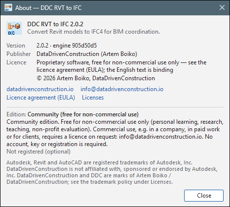

# DDC RVT to IFC 2.0 for Windows

Turn Revit models into IFC files that any BIM tool can open — without Revit and without any licence.
Made for architects, engineers, BIM coordinators and estimators who receive `.rvt` files and need to share,
check or count what is inside them.


*Two Revit models added to the list and ready to convert.*

## What you get

For every model, the app creates a folder next to it (for example `Family House.ifc-converted`) with:

| File | What it is | Open it with |
|---|---|---|
| IFC file (`.ifc`) | The whole model in the open IFC4 format, with properties, quantities, materials and classification | Any BIM viewer or tool: any IFC-capable BIM viewer or tool |
| `elements.xlsx` | A spreadsheet of every element: category, family, type, level, length, area, volume and parameters | Excel, LibreOffice, Power BI, Python |
| `model.glb` | A lightweight 3D model | DDC Data Viewer, Windows 3D Viewer, any web viewer |
| `conversion-report.html` | A short report: what was converted and what needs a look | Any web browser |

## Supported Revit versions

| Revit version the file was saved in | Supported |
|---|---|
| 2019, 2020, 2021, 2022, 2023, 2024, 2025, 2026, 2027 | Yes |
| `.rvt` projects and `.rfa` families | Yes |
| Older than 2019 | No — open and save the file in a newer Revit first |

## Getting started

1. **Download.** Get `DDC-RVT-to-IFC-…-portable.zip` (or the installer) from the
   [Releases page](https://github.com/datadrivenconstruction/cad2data-Revit-IFC-DWG/releases) and unzip it to any folder,
   for example `C:\DDC\RVT-to-IFC\`. Nothing else needs to be installed.
2. **Add your models.** Start `Revit to IFC.exe`, then drag `.rvt` or `.rfa` files (or a whole folder) into the window,
   or use **Add files…**.
3. **Choose what to include (optional).** The default profile *Full available data* suits most cases.
   Under **More options** you can pick units, the coordinate origin, which categories to export and more.

   
   *More options: length unit, coordinate origin, properties, quantities and filters.*

4. **Press Convert.** You can follow each file in the list; large models take a minute or two.

   
   *Conversion in progress: the status bar shows the current step and the elapsed time.*

5. **Open the result.** When the status says *Written*, click **Open output** in the status bar, or right-click the file
   and choose **Open folder**.

   
   _Done: each model has its own result folder. **With gaps** means the file was written and the report lists a few
   elements worth a look — click **What to check** to see them._

## Look at the result

Open `elements.xlsx` in Excel — or in the free [DDC Data Viewer](https://github.com/datadrivenconstruction/cad2data-Revit-IFC-DWG/releases),
which shows the table and the 3D model side by side.


*The element table of a curtain-wall model: 152 elements with category, family, type, level and dimensions; totals per category on the right.*


*Filter the table by Curtain Panels and they light up in 3D; click a row to find that element in the model.*

The app also has a dark theme (**More options → Interface**):


*The same window in the dark theme.*

## Command line

For batch jobs and scripts, use `cli\RVTconverter.exe` from the same folder:

```bat
:: IFC, spreadsheet and 3D model in a new folder
cli\RVTconverter.exe "C:\Projects\House\Family House.rvt" -o "C:\Projects\House\IFC" --ifc

:: IFC in millimetres, only doors and windows
cli\RVTconverter.exe "C:\Projects\House\Family House.rvt" --ifc --ifc-units mm --ifc-categories Doors,Windows
```

`cli\RVTconverter.exe --help` lists every option. The program returns 0 when everything was written,
2 when the result was written with notes in the report, and 1 when it failed.

## Frequently asked questions

**Do I need Revit or an account?** No. The app reads the files itself.

**Which Revit versions are supported?** Files saved in Revit 2016 to 2027 (older files from 2013 may open, best effort).

**Is it free?** Yes, for non-commercial use: learning, research, teaching and personal projects.
Using it in paid work, for clients, or inside a company product needs a commercial licence —
write to [info@datadrivenconstruction.io](mailto:info@datadrivenconstruction.io). Full terms: [EULA](../../EULA.md).


*Help → About shows the version and the licence.*

**Which Windows?** Windows 10 or 11, 64-bit. The portable version runs from any folder, even a USB stick.

**Are my files uploaded anywhere?** No. Everything happens on your computer; models never leave it,
and the app works without an internet connection.

**A file shows *Error* — what now?** Right-click it and choose **Copy error details**, then send them to us (see below).
Keep the whole unzipped folder together: the app needs the `cli` folder next to it.

**How do I update?** Download the new zip from [Releases](https://github.com/datadrivenconstruction/cad2data-Revit-IFC-DWG/releases)
and replace the contents of the folder.

## Help and feedback

- Questions, ideas or a file that does not convert: [open an issue](https://github.com/datadrivenconstruction/cad2data-Revit-IFC-DWG/issues)
  or use **Help → Feedback…** in the app.
- Commercial licences and projects: [info@datadrivenconstruction.io](mailto:info@datadrivenconstruction.io)
- Website: [datadrivenconstruction.io](https://datadrivenconstruction.io)

---

<sub>Screenshots: the models are the open samples `revit-openings_v22.rvt`, `Revit_IFC5_Einhoven.rvt`, `revit-elements_v20.rvt` and `revit-curtainwall-byprofile_v21.rvt` (MIT licence). See Trademarks in the main README.</sub>
