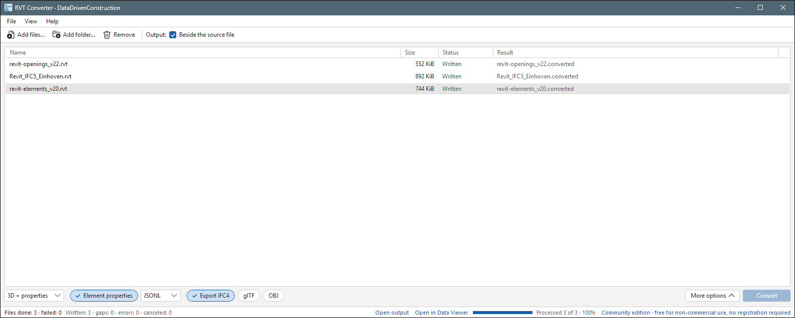
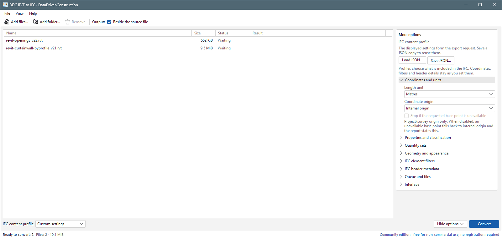
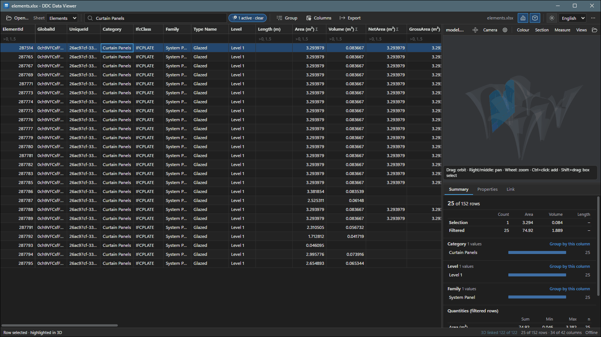

<p align="center">
  <a href="README.md">English</a> •
  <a href="README.de.md">Deutsch</a> •
  <a href="README.es.md">Español</a> •
  <a href="README.fr.md">Français</a> •
    <a href="README.pt-BR.md">Português (Brasil)</a> •
  <a href="README.zh.md">中文</a> •
  <a href="README.ja.md">日本語</a> •
  <a href="README.ar.md">العربية</a>
</p>

<p align="center"><sub>هل التنزيل بطيء جدًا أو GitHub محظور؟ استخدم النسخة المرآة: <a href="https://cadbimconverter.com/download/">cadbimconverter.com/download</a> (الملفات نفسها ومجاميع SHA-256 نفسها).</sub></p>

<div dir="rtl">

<h1 align="center">cad2data — محولات DDC لملفات RVT وIFC وDWG</h1>

<p align="center">
  <b>حوّل ملفات CAD/BIM إلى بيانات مفتوحة ومنظمة — محليًا ودون اتصال وبدون تراخيص CAD.</b><br>
  .rvt / .rfa → GLB · glTF · OBJ · IFC4 · JSONL/CSV &nbsp;|&nbsp; .ifc → Excel · JSONL · SQLite &nbsp;|&nbsp; .dwg → Excel · CSV · JSONL · DXF · SVG
</p>

<p align="center">
  <a href="https://github.com/datadrivenconstruction/cad2data-Revit-IFC-DWG/releases/latest"></a>
  
  
  
  <a href="LICENSE"></a>
</p>

<p align="center">
  
</p>

---

<a id="whats-new-in-ddc-converters-20"></a>
## الجديد في DDC Converters 2.0

DDC Converters 2.0 هو إصدار أكتوبر 2026 لخط المنتجات بالكامل: RVT Converter 2.0 وRVT to IFC 2.0
وIFC to Excel 2.0 وCAD Drawing to Excel 2.0 وData Viewer 2.0 وExcel Add-in 2.0.
البنية الحالية لـ RVT Converter وRVT to IFC هي [2.0.2](https://github.com/datadrivenconstruction/cad2data-Revit-IFC-DWG/releases/tag/v2.0.2).

- **أداة واحدة لكل عائلة صيغ.** تحويل `.rvt` / `.rfa` إلى GLB وglTF وOBJ وIFC4 وجداول JSONL / CSV / SQLite؛
  و`.ifc` / `.ifczip` إلى Excel وJSONL وSQLite؛ و`.dwg` إلى Excel وCSV وJSONL وDXF وSVG.
- **ملفات Revit 2016–2027** تُقرأ مباشرة، دون الحاجة إلى تثبيت Revit.
- **تصدير IFC4 من Revit** مع مجموعات الخصائص والكميات والتصنيف والمواد، وبالملفات الشخصية
  `full` و`coordination` و`geometry`؛ وخيارات الوحدات ونقطة الأصل والفئة والمرحلة عبر سطر الأوامر.
- **معرّفات العناصر في كل مكان.** تحتفظ كل عقدة هندسية بمعرّف العنصر الأصلي، فتُربط الجداول والنموذج ثلاثي الأبعاد عبر `ElementId`.
- **تقرير لكل تشغيل.** يسرد `report.json` / `summary.json` ما قُرئ وما تم تخطيه، مع الأعداد.
- **تطبيقات سطح المكتب وسطر الأوامر** لكل محول، مع رموز خروج مناسبة للمعالجة الدفعية وحالة JSON في سطر واحد للسكربتات.
- **DDC Data Viewer 2.0:** عارض مجاني للجداول والنموذج ثلاثي الأبعاد مع ربط ثنائي الاتجاه بين الصفوف والعناصر.
- **دون اتصال وقابل للنقل.** Windows 10/11 x64، ولا حاجة لتثبيت شيء سوى الحزمة (مثبّت أو zip محمول).
  محولات سطر الأوامر لنظامي Linux (x64، arm64) وmacOS (arm64، x64) وData Viewer متاحة في [Releases](https://github.com/datadrivenconstruction/cad2data-Revit-IFC-DWG/releases/tag/v2026.10.1) (انظر [DDC_LINUX_Converters](DDC_LINUX_Converters/README.md)).

التنزيل: [`DDC_WINDOWS_Converters/`](DDC_WINDOWS_Converters/) (محمولة وجاهزة للتشغيل) و
[صفحة الإصدارات](https://github.com/datadrivenconstruction/cad2data-Revit-IFC-DWG/releases) (المثبّتات والحزم).

<a id="contents"></a>
## المحتويات

- [المحولات](#converters)
- [لقطات الشاشة](#screenshots)
- [البدء السريع](#quick-start)
- [سطر الأوامر](#command-line)
- [المعالجة الدفعية والأتمتة](#batch-processing-and-automation)
- [DDC Data Viewer](#ddc-data-viewer)
- [أدوات مجانية: فحص البيانات وحصر الكميات وPower BI وExcel](#free-tools-data-check-quantity-take-off-power-bi-and-excel)
- [مسارات n8n ودفاتر Notebooks ووكلاء الذكاء الاصطناعي](#n8n-workflows-notebooks-and-ai-agents)
- [النطاق المدعوم وملاحظات](#supported-scope-and-notes)
- [بنية المستودع](#repository-layout)
- [الترخيص](#licensing)
- [العلامات التجارية](#trademarks)

<a id="converters"></a>
## المحولات

| الحزمة | الإصدار | المدخلات | المخرجات | الواجهة |
|---|---|---|---|---|
| **DDC RVT Converter** | 2.0 | `.rvt` و`.rfa` المحفوظة من Revit 2016–2027 | GLB (الافتراضي) وglTF وOBJ وIFC4، وجدول العناصر (`elements.xlsx` و`elements.csv`: الفئة والعائلة والنوع والمستوى والمساحة والحجم والطول والمعاملات)، والخصائص المحفوظة بصيغة JSONL؛ ويكتب تطبيق سطح المكتب أيضًا جداول CSV وSQLite | تطبيق سطح مكتب + سطر الأوامر `RVTconverter.exe` |
| **DDC RVT to IFC** | 2.0 | `.rvt` و`.rfa` | IFC4 مع مجموعات الخصائص والكميات والتصنيف والمواد؛ الملفات الشخصية `full` و`coordination` و`geometry` | تطبيق سطح مكتب (سطر الأوامر نفسه كما في RVT Converter) |
| **DDC IFC to Excel** | 2.0 | ملفات IFC2x3 / IFC4 STEP و`.ifczip` | `drawing.xlsx` (الكائنات والخصائص والكميات) و`data.jsonl` و`data.sqlite` و`result.json` | تطبيق سطح مكتب + سطر الأوامر |
| **DDC CAD Drawing to Excel** | 2.0 | مخططات `.dwg` بإصدارات الصيغة R13–2018 | `.xlsx` (Entities وSummary وLayers وBlocks) و`.csv` و`.jsonl` و`.dxf` و`.svg` و`report.json` | تطبيق سطح مكتب + سطر الأوامر `dwg2excel.exe` |
| **DDC Data Viewer** | 2.0 | جداول `.xlsx` و`.csv` و`.jsonl` و`.parquet` + هندسة `.glb` / `.dae` | عروض مُرشَّحة إلى XLSX / CSV | تطبيق سطح مكتب (مجاني) |

تحتفظ كل عقدة هندسية يكتبها RVT Converter بمعرّف العنصر الأصلي، فيمكن ربط الجداول والنموذج ثلاثي الأبعاد
عبر `ElementId`. تعمل جميع الحزم دون اتصال تمامًا على Windows 10/11 x64 ولا تحتاج إلى Excel
ولا إلى تثبيت Python. إصدارات سطر الأوامر لنظامي Linux وmacOS في [إصدار v2026.10.1](https://github.com/datadrivenconstruction/cad2data-Revit-IFC-DWG/releases/tag/v2026.10.1).

<a id="screenshots"></a>
## لقطات الشاشة

جميع لقطات الشاشة أدناه مأخوذة من تشغيلات فعلية لحزم الإصدار الحالي. وهي تستخدم نماذج
Revit النموذجية المفتوحة (ترخيص MIT)، والمبنى النموذجي الاصطناعي الخاص بالعارض، وعيّنة IFC المفتوحة في [`Sample_Projects/`](Sample_Projects/).

| | |
|---|---|
|  |  |
| **DDC RVT Converter** — تحويل نموذجين من Revit؛ ويُعرض مجلد النتيجة لكل ملف. | **DDC RVT to IFC** — وحدة الطول ونقطة أصل الإحداثيات وبقية إعدادات IFC ضمن *More options*. |
|  |  |
| **DDC Data Viewer** — يؤدي المرشّح على *Structural Columns* إلى إبراز العناصر المرتبطة في العرض ثلاثي الأبعاد؛ وتجمع لوحة الملخص المساحة والحجم والطول. | **DDC IFC to Excel** — ملف `drawing.xlsx` لعيّنة Duplex IFC المفتوحة، مجمّعًا حسب فئة IFC (333 كائنًا و23 فئة). |
|  |  |
| **سطر الأوامر** — يكتب `RVTconverter.exe` ملفات GLB وIFC4 وجدول العناصر والتقارير، ويطبع ملخص الحالة. | **السمة الداكنة** — Data Viewer بالسمة الداكنة، ومفتاح تبديل لغة الواجهة في أعلى اليمين. |

<a id="quick-start"></a>
## البدء السريع

1. افتح [إصدار 2.0.2](https://github.com/datadrivenconstruction/cad2data-Revit-IFC-DWG/releases/tag/v2.0.2) (RVT Converter وRVT to IFC) أو [صفحة الإصدارات](https://github.com/datadrivenconstruction/cad2data-Revit-IFC-DWG/releases) (الحزم الأخرى)
   ونزّل الحزمة التي تحتاجها — ملف `*-Setup.exe` (مثبّت لكل مستخدم) أو `*-portable.zip`.
2. تحقق من التنزيل باستخدام `SHA256SUMS.txt` من الإصدار نفسه:
   ```powershell
   Get-FileHash .\DDC-RVT-Converter-*-portable.zip -Algorithm SHA256
   ```
3. فُكّ ضغط الحزمة المحمولة في مجلد من اختيارك، مثل `C:\DDC\RVT-Converter\`
   أو `C:\DDC\IFC-to-Excel\` أو `C:\DDC\DWG-to-Excel\`. أبقِ بنية المجلدات كما هي.
4. شغّل تطبيق سطح المكتب (`RVT Converter.exe` أو `IFC to Excel.exe` أو `DWG to Excel.exe`)، وأفلت الملفات أو
   المجلدات في النافذة واضغط *Convert* — أو استخدم سطر الأوامر أدناه.
5. افتح النتيجة في Excel أو Python/pandas أو [DDC Data Viewer](#ddc-data-viewer).

قد يطلب Windows SmartScreen تأكيدًا عند أول تشغيل لتنزيل جديد؛ تحقق من مجموع SHA-256 من الإصدار.

<a id="command-line"></a>
## سطر الأوامر

شُغّلت الأمثلة أدناه بالملفات التنفيذية للإصدار الحالي. تفترض المسارات أن الحزم المحمولة
فُكّ ضغطها في `C:\DDC\`.

### DDC RVT Converter — `RVTconverter.exe`

```powershell
# GLB + reports into "Project.converted" next to the input (existing folders are never overwritten)
C:\DDC\RVT-Converter\cli\RVTconverter.exe "C:\Models\Project.rvt"

# choose the output folder, add saved properties (JSONL) and an IFC4 file
C:\DDC\RVT-Converter\cli\RVTconverter.exe "C:\Models\Project.rvt" -o "C:\Out\Project" --properties --ifc

# IFC for coordination: millimetres, survey point origin, only doors and windows
C:\DDC\RVT-Converter\cli\RVTconverter.exe "C:\Models\Project.rvt" --ifc --ifc-profile coordination `
    --ifc-units mm --ifc-origin survey-point --ifc-categories Doors,Windows

# additional geometry formats
C:\DDC\RVT-Converter\cli\RVTconverter.exe "C:\Models\Family.rfa" --gltf --obj
```

| المخرج | متى | المحتوى |
|---|---|---|
| `native_graph.glb` | دائمًا | مجسّمات ثلاثية الأبعاد، عقدة واحدة لكل عنصر، مسمّاة بـ ElementId |
| `summary.json`, `report.json` | دائمًا | الحالة والأعداد وما تم إغفاله وتشخيصات لكل عنصر |
| `properties.jsonl`, `property_scopes.jsonl` (+ manifests) | `--properties` | المعاملات المحفوظة لكل عنصر (كائن JSON واحد في كل سطر) |
| `native_graph.ifc`, `ifc.manifest.json`, `ifc.settings.json` | `--ifc` | IFC4 (هندسة مجزّأة ومجموعات خصائص وكميات) |
| `native_graph.gltf` + `.bin`, `native_graph.obj` + `.mtl` | `--gltf`, `--obj` | الهندسة نفسها كما في GLB؛ وOBJ بالمتر ومحور Y للأعلى |

رموز الخروج: `0` كُتب دون ثغرات مُبلَّغ عنها، و`2` كُتب مع ثغرات مُبلَّغ عنها (أو وسائط غير صالحة)،
و`1` فشل في التحويل أو الإدخال/الإخراج. شغّل `RVTconverter.exe --help` لمعرفة جميع خيارات IFC
(`--ifc-config` و`--ifc-phase` و`--ifc-design-options` و`--ifc-exclude-categories` وغيرها).

### DDC IFC to Excel

سطر أوامر الحزمة المحمولة:

```powershell
C:\DDC\IFC-to-Excel\runtime\python.exe C:\DDC\IFC-to-Excel\sources\ifc-excel\converter.py `
    "C:\Models\Building.ifc" --output "C:\Out\Building"
```

يطبع الأمر سطر JSON واحدًا (`"status": "CONVERTED"` أو `"CONVERTED_WITH_LIMITS"` أو `"FAILED"`)
وينشئ مجلدًا فرعيًا جديدًا يضم `drawing.xlsx` و`data.jsonl` و`data.sqlite` و`result.json`.
تُقبل ملفات `.ifczip` مباشرة.

### DDC CAD Drawing to Excel — `dwg2excel.exe`

```powershell
# one or more drawings; a new sub-folder per drawing
C:\DDC\DWG-to-Excel\cli\dwg2excel.exe "C:\Drawings\Plan.dwg" -o "C:\Out"

# a whole folder: tables only, one JSON line per file for scripts
$dwg = (Get-ChildItem C:\Drawings -Filter *.dwg).FullName
C:\DDC\DWG-to-Excel\cli\dwg2excel.exe @dwg -o C:\Out --no-dxf --no-svg --json
```

يضم مجلد كل مخطط الملفات `<name>.xlsx` و`<name>.csv` و`<name>.jsonl` و`<name>.dxf` و`<name>.svg`
و`report.json` و`REPORT.txt`. ويبيّن سطر وحدة التحكم عدد السجلات التي فُكّ ترميزها أو تم تخطيها أو
كانت من نوع غير مدعوم. خيارات أخرى: `--timeout` و`--memory-limit-mb`
و`--language en|ru` و`--version`.

<a id="batch-processing-and-automation"></a>
## المعالجة الدفعية والأتمتة

**PowerShell — كل ملف RVT في شجرة مجلدات:**

```powershell
$exe = "C:\DDC\RVT-Converter\cli\RVTconverter.exe"
Get-ChildItem "C:\Projects" -Recurse -Include *.rvt | ForEach-Object {
    & $exe $_.FullName -o (Join-Path "C:\Out" $_.BaseName) --properties --ifc
    "{0}: exit {1}" -f $_.Name, $LASTEXITCODE
}
```

**Python — تحميل خصائص RVT وجداول IFC باستخدام pandas:**

```python
import json, subprocess, pandas as pd

subprocess.run([r"C:\DDC\RVT-Converter\cli\RVTconverter.exe", r"C:\Models\Project.rvt",
                "-o", r"C:\Out\Project", "--properties"], check=False)
rows = [json.loads(line) for line in open(r"C:\Out\Project\properties.jsonl", encoding="utf-8")]
print(len(rows), "property records")

objects = pd.read_excel(r"C:\Out\Building\Building-<id>\drawing.xlsx", sheet_name="Objects")
print(objects.groupby("Category").size().sort_values(ascending=False))
```

**DWG في CI أو الروبوتات:** يطبع `dwg2excel.exe --json` سطر JSON واحدًا لكل مخطط؛ حلّله لجمع
الحالة ومجلد المخرجات وإحصاءات فك الترميز.

<a id="ddc-data-viewer"></a>
## DDC Data Viewer

عارض مجاني لسطح المكتب لمخرجات المحولات: شبكة افتراضية تتسع لأكثر من 100 ألف صف، وبحث ومرشّحات
وتجميع مع المجاميع، ومنتقي أعمدة، وتصدير العرض الحالي إلى XLSX/CSV، ولوحة ثلاثية الأبعاد تربط
الصفوف بالعناصر في الاتجاهين (GLB أو DAE). الإنجليزية والألمانية والروسية؛ وسمة فاتحة وداكنة.
نزّل `DDC-Data-Viewer-<version>-Setup.exe` أو ملف zip المحمول من الإصدار.

<a id="free-tools-data-check-model-diff-bcf-issues-quantity-take-off-power-bi-and-excel"></a>
<a id="free-tools-data-check-quantity-take-off-power-bi-and-excel"></a>
## أدوات مجانية: فحص البيانات ومقارنة النماذج وقضايا BCF وحصر الكميات وPower BI وExcel

يعمل [`ddc-tools/`](ddc-tools/) (Python 3.9+ وترخيص MIT ودون اتصال) على الجداول التي تكتبها المحولات
(XLSX وCSV وJSONL وSQLite وJSON):

- يتحقق `ddc check` من مخرجات التصدير وفق قواعد YAML (المعاملات المطلوبة والتعابير النمطية وعدم التكرار والنطاقات
  والقيم المسموحة) ويكتب ملف XLSX بإشارات المرور مع تفاصيل ElementId / GlobalId، وتقرير JSON، ورمز
  خروج للاستخدام في CI.
- يقارن `ddc diff` بين تصديرين لنموذج (مخرجات محول RVT أو IFC أو DWG): العناصر المضافة / المحذوفة / المعدّلة،
  والقيم القديمة والجديدة لكل خاصية وكمية، وسجل تغييرات بصيغة XLSX وJSON، وملف GLB ملوّن بحسب حالة التغيير، ورمز خروج للاستخدام في CI.
- يكتب `ddc bcf` نتائج `ddc check` و`ddc diff` في ملفات قضايا BCF 2.1 / 3.0 (المكوّنات بحسب IFC GlobalId) و
  يحوّل أي ملف BCF إلى جدول XLSX. BCF صيغة مفتوحة من buildingSMART؛ ولا يُدّعى الحصول على أي اعتماد.
- يجمع `ddc qto` العدد والطول والمساحة والحجم بحسب الفئة والنوع والمستوى في ملف XLSX منسّق، ويحذّر
  من الكميات المفقودة أو الصفرية.
- [`ddc-tools/powerbi/`](ddc-tools/powerbi/) و[`ddc-tools/excel/`](ddc-tools/excel/): سكربتات Power Query
  وملف Excel يقرآن مجلد تصدير كاملًا دون الحاجة إلى Python
  ([الخطوات](ddc-tools/docs/POWER_QUERY.md)).

```bash
pip install ./ddc-tools
ddc check Project.converted --rules ddc-tools/examples/rules_basic.yaml --xlsx check.xlsx
ddc qto Project.converted --xlsx qto.xlsx
ddc diff Model_v1.converted Model_v2.converted --xlsx changes.xlsx --glb diff.glb --bcf changes.bcf
```

Excel وPower BI علامتان تجاريتان لشركة Microsoft Corporation، وتُستخدمان فقط لبيان ما تعمل معه الملفات.

<a id="n8n-workflows-notebooks-and-ai-agents"></a>
## مسارات n8n ودفاتر Notebooks ووكلاء الذكاء الاصطناعي

- [`DDC_n8n_Workflows&Pipelines/`](DDC_n8n_Workflows&Pipelines/) — تسعة مسارات n8n (التحويل،
  والتحقق الدفعي، والتصنيف بالذكاء الاصطناعي، وتقدير التكلفة وثاني أكسيد الكربون، وتقارير QTO).
- [`DDC_in_additon/DDC_python_pipelines/`](DDC_in_additon/DDC_python_pipelines/) — دفاتر Jupyter للتحويل
  والمعالجة الدفعية والتحليلات.

> **الإعداد:** تستدعي المسارات والدفاتر المحولات الموجودة في [`DDC_WINDOWS_Converters/`](DDC_WINDOWS_Converters/) عبر `ddc convert` /
> `ddc table` (الأداة المجانية [`ddc-tools/`](ddc-tools/))، التي تبني الجدول المسطّح (`<name>_rvt.xlsx`، الورقة `Project_Data`:
> `ID` و`Category` و`Type Name` و`Level` و`Volume` وغيرها) من مخرجات `properties.jsonl` / IFC / DWG؛ والهندسة ثلاثية الأبعاد بصيغة GLB.
> إعداد لمرة واحدة: `pip install ddc-tools\`. يوضح ملف `README.md` المجاور للمسارات والدفاتر ما جرى فحصه وما
> لا تغطيه (مثلًا: خطوات الذكاء الاصطناعي في n8n 5-7 تتطلب بيانات اعتمادك؛ والجداول الزمنية وملفات PDF للوحات
> ليس لها مكافئ؛ وكميات Revit تأتي من كميات IFC أو من شبكة GLB).

- [`AI_AGENTS_INSTRUCTIONS/`](AI_AGENTS_INSTRUCTIONS/) — سياق جاهز لوكلاء البرمجة
  (وكلاء البرمجة بالذكاء الاصطناعي) مع أسطر الأوامر الحالية. افتح المستودع في
  الوكيل واطلب مثلًا: *"convert every .rvt in C:\Projects to IFC and summarise the reports"*.
- [DDC Skills for AI agents](https://github.com/datadrivenconstruction/DDC_Skills_for_AI_Agents_in_Construction)
  — أتمتة جاهزة لبيانات الإنشاءات.

<a id="supported-scope-and-notes"></a>
## النطاق المدعوم وملاحظات

- **RVT:** لا تُصدَّر الخامات؛ ويكتب تصدير IFC ملف IFC4 مجزّأ الهندسة. العناصر التي لا يمكن
  تمثيلها مدرجة في تقرير التشغيل.
- **IFC:** ملفات IFC2x3 وIFC4 STEP و`.ifczip`؛ وIFCXML غير مدعوم. تبقى السجلات الأصلية دائمًا في
  `data.jsonl` / `data.sqlite`.
- **DWG:** المخططات R13–2018. تُدرج بعض أنواع الكائنات (مثل بعض الجداول والخطوط الإرشادية المتعددة والمجسّمات ثلاثية الأبعاد
  والصور) على أنها *unsupported* في `report.json` بدل تصديرها بشكل غير صحيح.
- **المنصات:** Windows 10/11 x64. **Linux (x64، arm64) وmacOS (arm64، x64): محولات سطر الأوامر وData Viewer، انظر [Releases](https://github.com/datadrivenconstruction/cad2data-Revit-IFC-DWG/releases/tag/v2026.10.1).**

نرحّب كثيرًا ببلاغات الأخطاء المرفقة بملف مثال صغير — يُرجى استخدام
[GitHub Issues](https://github.com/datadrivenconstruction/cad2data-Revit-IFC-DWG/issues) وعدم إرفاق
نماذج سرية.

<a id="repository-layout"></a>
## بنية المستودع

| المسار | المحتوى |
|---|---|
| `docs/` | ملاحظات الإصدار ولقطات الشاشة |
| `ddc-tools/` | أدوات مجانية لفحص البيانات ومقارنة النماذج وقضايا BCF وحصر الكميات وحزمة Power BI وExcel |
| `DDC_n8n_Workflows&Pipelines/` | ملفات JSON لمسارات n8n |
| `DDC_in_additon/` | دفاتر Notebooks وعروض تقديمية وصور |
| `AI_AGENTS_INSTRUCTIONS/` | تعليمات لوكلاء البرمجة بالذكاء الاصطناعي |
| `DDC_WINDOWS_Converters/` | محولات Windows المحمولة (RVT وRVT-to-IFC وIFC to Excel وCAD Drawing to Excel وData Viewer) ونصوص التراخيص ووثائق إضافة Excel → Revit؛ والمثبّتات في صفحة Releases |
| `DDC_LINUX_Converters/` | حزم بيانات CWICR وتغليف Qdrant ولوحة القياس عن بُعد |
| `Sample_Projects/` | ملفات IFC نموذجية مفتوحة |

<a id="licensing"></a>
## الترخيص

- **المسارات ودفاتر Notebooks والسكربتات وتعليمات الذكاء الاصطناعي والوثائق و`ddc-tools`** — [ترخيص MIT](LICENSE).
  مفتوحة المصدر، والاستخدام التجاري مسموح.
- **محولات DDC** (الحزم الثنائية في Releases وفي `DDC_WINDOWS_Converters/` / `DDC_LINUX_Converters/`) —
  برمجيات مملوكة، **مجانية للاستخدام غير التجاري فقط**. **الاستخدام التجاري يتطلب ترخيصًا عند الطلب:**
  [info@datadrivenconstruction.io](mailto:info@datadrivenconstruction.io). الشروط: [EULA](EULA.md)
  و[LICENSE-PROPRIETARY](LICENSE-PROPRIETARY) و[NOTICE](NOTICE). المكوّنات مفتوحة المصدر من جهات خارجية
  وتراخيصها مدرجة في `licenses/` داخل كل حزمة.
- لا يمتد ترخيص MIT الخاص بـ `ddc-tools` إلى المحولات التي يستدعيها.

**الاستخدام التجاري** يعني أي استخدام من قبل أو نيابةً عن شركة أو منشأة أعمال أو محترف يعمل لحسابه أو جهة
حكومية أو أي منظمة أخرى (بما في ذلك موظفوها أو المتعاقدون معها)؛ أو في عمل أو خدمات مدفوعة، بما في ذلك
معالجة الملفات للعملاء؛ أو في مشروع يحقق إيرادات أو يُقصد به تحقيقها؛ أو داخل
منتج أو خدمة أو مسار معالجة أو عرض SaaS متاح للآخرين. ويشمل ذلك إعادة التوزيع والتكامل مع OEM وSaaS.
**الاستخدام غير التجاري** يعني التعلم الشخصي والهواية، والبحث الأكاديمي، والتدريس والدراسة من قبل
الطلاب والمدرّسين، والتقييم من قبل المنظمات غير الربحية، وذلك كله دون مقابل مادي أو إيرادات
أو غرض تجاري.

بلاغات الأمان: انظر [SECURITY.md](SECURITY.md). براءات الاختراع والعلامات التجارية وضوابط التصدير:
[PATENTS.md](PATENTS.md) و[TRADEMARK.md](TRADEMARK.md) و[EXPORT-COMPLIANCE.md](EXPORT-COMPLIANCE.md).

<a id="consulting-and-training"></a>
## الاستشارات والتدريب

تساعد DataDrivenConstruction شركات الإنشاءات والهندسة والتقنية على أتمتة معالجة بيانات CAD/BIM
وبناء مسارات ETL مفتوحة — ورش عمل واستشارات ونماذج أولية على بياناتكم الحقيقية.
تواصلوا عبر [info@datadrivenconstruction.io](mailto:info@datadrivenconstruction.io) أو زوروا
[datadrivenconstruction.io](https://datadrivenconstruction.io).

<p>
  <a href="https://x.com/datadrivenconst"></a>
  <a href="https://www.youtube.com/@datadrivenconstruction"></a>
  <a href="https://www.linkedin.com/company/78381569"></a>
</p>

إذا كانت هذه الأدوات مفيدة لك، فضع نجمة على المستودع لتصلك إشعارات الإصدارات الجديدة.

<a id="trademarks"></a>
## العلامات التجارية

Autodesk وRevit علامتان تجاريتان لشركة Autodesk, Inc. تُعدّ DataDrivenConstruction برمجيات مستقلة وغير تابعة لشركة Autodesk, Inc. ولا مدعومة منها. RVT وRFA وDWG وDXF وIFC أسماء صيغ ملفات تُستخدم فقط لبيان الملفات التي تُقرأ.

</div>
