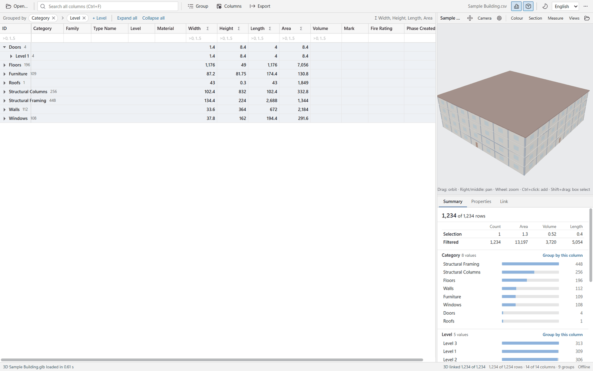
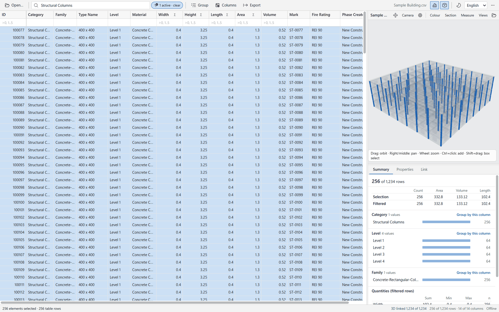
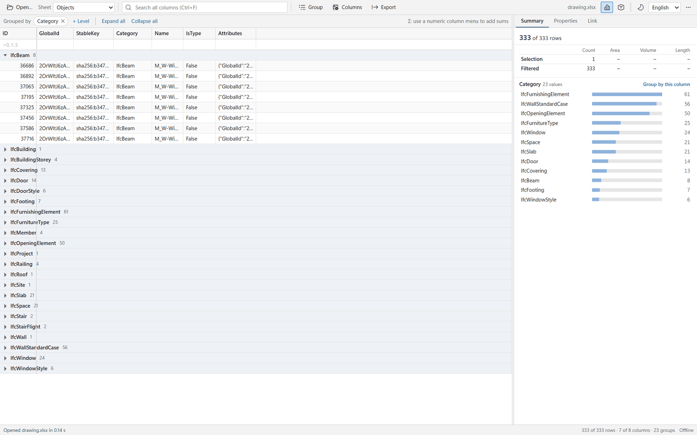
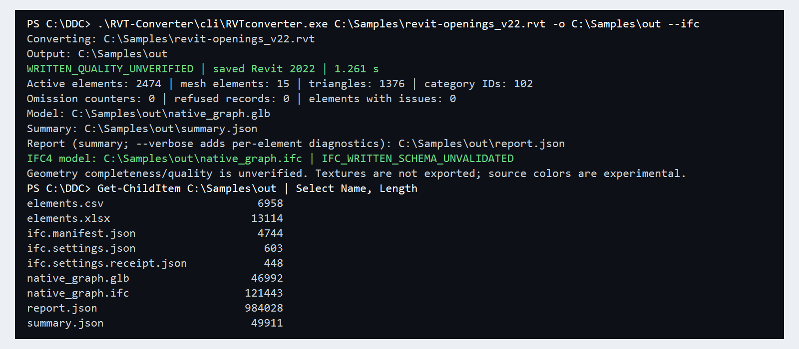
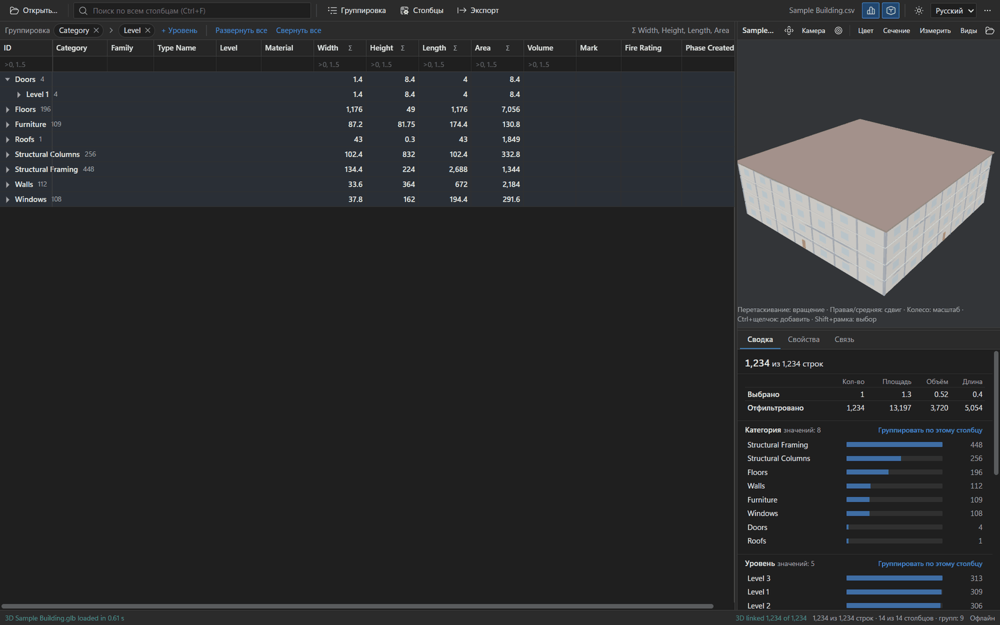

<p align="center">
  <a href="README.md">English</a> •
  <a href="README.de.md">Deutsch</a> •
  <a href="README.es.md">Español</a> •
  <a href="README.fr.md">Français</a> •
  <a href="README.ru.md">Русский</a> •
  <a href="README.zh.md">中文</a> •
  <a href="README.ar.md">العربية</a>
</p>

# cad2data — DDC-Konverter für RVT-, IFC- und DWG-Dateien

**CAD/BIM-Dateien lokal, offline und ohne CAD-Lizenzen in offene, strukturierte Daten umwandeln.**

<p align="center"></p>

## Neu im Oktober 2026

Die Konverter wurden auf **eigene Dateileser von DataDrivenConstruction** umgestellt (RVT: Rust, IFC und DWG: Python) und benötigen kein CAD-SDK von Drittanbietern mehr. Die alten Programme der Generation 18.x (`RvtExporter.exe`, `IfcExporter.exe`, `DwgExporter.exe`, `DgnExporter.exe`, `RVT2IFCconverter.exe`) sind eingestellt und nicht mehr im Repository; die neuen Pakete liegen auf der [Releases-Seite](https://github.com/datadrivenconstruction/cad2data-Revit-IFC-DWG/releases). DGN wird vorerst nicht unterstützt. Alle neuen Konverter sind Vorschauversionen und schreiben zu jedem Lauf einen Bericht darüber, was gelesen, übersprungen oder abgelehnt wurde.

## Konverter

| Paket | Version | Liest | Schreibt |
|---|---|---|---|
| **DDC RVT Converter** | 0.6.8 | `.rvt`, `.rfa` (Autodesk® Revit® 2019–2027) | GLB, glTF, OBJ, IFC4, JSONL / CSV |
| **DDC RVT to IFC** | 0.6.8 | `.rvt`, `.rfa` | IFC4 |
| **DDC IFC to Excel** | 0.3.1 preview | IFC2x3 / IFC4, `.ifczip` | XLSX, JSONL, SQLite |
| **DDC DWG to Excel** | 0.4.1 | `.dwg` (R13–2018) | XLSX, CSV, JSONL, DXF, SVG |
| **DDC Data Viewer** | 0.1.2 | XLSX, CSV, JSONL, Parquet + GLB / DAE | XLSX, CSV |

Alle Pakete laufen offline unter Windows 10/11 x64 und benötigen weder Autodesk-Software noch Excel oder Python. Jedes Geometrie-Element des RVT Converters trägt die native Element-ID, sodass Tabellen und 3D verknüpft werden können.

## Screenshots

Echte Läufe der aktuellen Pakete: synthetisches Beispielgebäude des Viewers und das offene IFC-Beispiel aus `Sample_Projects/`.

| | |
|---|---|
|  |  |
|  |  |

## Schnellstart

1. Paket aus dem [neuesten Release](https://github.com/datadrivenconstruction/cad2data-Revit-IFC-DWG/releases/latest) laden (`*-Setup.exe` oder `*-portable.zip`) und mit `SHA256SUMS.txt` prüfen.
2. Portable-Paket z. B. nach `C:\DDC\` entpacken.
3. Desktop-App starten, Dateien hineinziehen und konvertieren — oder die Kommandozeile verwenden:

```powershell
# RVT / RFA -> GLB + IFC4 + properties (JSONL)
C:\DDC\RVT-Converter\cli\RVTconverter.exe "C:\Models\Project.rvt" -o "C:\Out\Project" --properties --ifc

# IFC / IFCZIP -> Excel + JSONL + SQLite
C:\DDC\IFC-to-Excel
untime\python.exe C:\DDC\IFC-to-Excel\sources\ifc-excel\converter.py "C:\Models\Building.ifc" --output "C:\Out\Building"

# DWG -> Excel + CSV + JSONL + DXF + SVG
C:\DDC\DWG-to-Excel\cli\dwg2excel.exe "C:\Drawings\Plan.dwg" -o "C:\Out"
```

Alle Optionen, Ausgabedateien und Exit-Codes: siehe [englisches README](README.md#command-line).

## n8n-Workflows, Notebooks und KI-Agenten

Die n8n-Workflows (`DDC_n8n_Workflows&Pipelines/`) und Jupyter-Notebooks wurden für die alte 18.x-Kommandozeile (XLSX + DAE) geschrieben und werden auf die neuen Konverter portiert. Bis dahin den Konverterpfad anpassen und den Parsing-Schritt ändern (RVT-Eigenschaften als `properties.jsonl`, Geometrie als GLB). `AI_AGENTS_INSTRUCTIONS/` enthält bereits die neuen Befehle.

## Einschränkungen

RVT: Vollständigkeit der Geometrie nicht zertifiziert, keine Texturen, IFC4 tesselliert. IFC: kein IFCXML. DWG: einige Objekttypen werden als nicht unterstützt gemeldet statt falsch exportiert — `report.json` prüfen. Vorerst nur Windows x64; Linux / macOS — coming soon.

## Lizenz

Workflows, Notebooks, Skripte und Dokumentation: [MIT](LICENSE). Konverter-Pakete: kostenlos für private und gewerbliche Nutzung gemäß der mitgelieferten DataDrivenConstruction-EULA; siehe [LICENSE-PROPRIETARY](LICENSE-PROPRIETARY) und [NOTICE](NOTICE). Kontakt: info@datadrivenconstruction.io

## Marken

Autodesk®, Revit® und AutoCAD® sind eingetragene Marken von Autodesk, Inc. IFC und buildingSMART® sind Marken von buildingSMART International Ltd. Dateiformatnamen (RVT, RFA, DWG, DXF, DGN) dienen nur der Bezeichnung von Dateiformaten. DataDrivenConstruction ist nicht mit Autodesk, Inc. verbunden und wird von Autodesk weder unterstützt noch zertifiziert. Die DDC-Produkte sind unabhängige Software für Interoperabilität und enthalten bzw. verwenden keine Autodesk-Software, -SDKs oder -Quellcode. Vollständiger Text: [README.md](README.md#trademarks).
