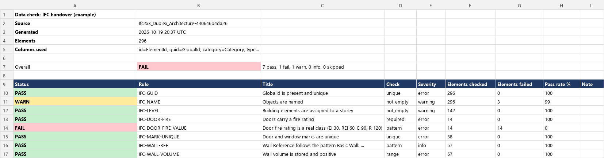
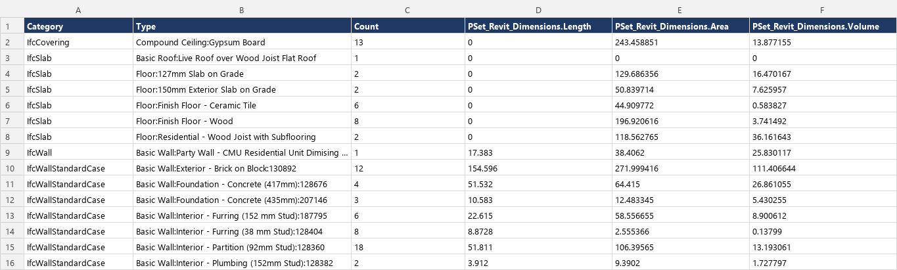

# DDC free tools

Three small, free, offline tools for the tables written by the DDC converters (RVT, IFC, DWG to
XLSX, CSV, JSONL, SQLite or JSON). Your data stays on your machine: no upload, no account, no cloud.

| Tool | What it does |
|---|---|
| `ddc check` | Rule-based data quality check (required parameters, regex, uniqueness, ranges, allowed values). Traffic-light XLSX, JSON, exit code for CI. |
| `ddc qto` | Quantity summary by category, type and level (count, length, area, volume, whichever the export has) with warnings about gaps. |
| Power BI and Excel kit | Power Query (M) scripts and an Excel workbook that read a whole export folder. No Python needed. |

Python 3.9+, dependencies: `openpyxl` and `PyYAML` (both permissive licences). MIT licence, see the
[repository licence](../LICENSE) for the scope.

## Install

```bash
cd ddc-tools
pip install .          # gives the `ddc` command
# or run without installing:  PYTHONPATH=src python -m ddc_tools --help
```

## What the tools read

A **folder** with converter output or a single file: `.xlsx` (first sheet, or `--sheet`), `.csv`,
`.jsonl` (nested objects are flattened to `Pset.Property` columns), `.json` (list of objects) and
`.sqlite` (table `elements`, else the widest table, or `--table`). If a folder holds several formats,
the first present is used in this order: sqlite, jsonl, xlsx, csv, json (`--format xlsx` forces one).
Helper files such as `geometry_index.jsonl` or `*manifest*` are skipped.

### Converter outputs (no manual mapping)

* **DDC IFC to Excel** writes a relational model (`Objects`, `Properties`, `Quantities`, `SpatialLinks`,
  `TypeLinks` in `drawing.xlsx`, `data.jsonl` or `data.sqlite`). The tools join it into one row per object:
  `ElementId` (STEP id), `GlobalId`, `Category` (IFC class), `Name`, `TypeName` (from the type
  relation, else `ObjectType`), `Level` (storey by containment or aggregation; an opening takes the
  storey of its host wall, Revit-style `Level` properties are the fallback) and one column per property or
  quantity named `<Set>.<Property>`, for example `Pset_WallCommon.FireRating`. Stored `IfcElementQuantity`
  values and length, area and volume measures of property sets count as quantities (property sets of
  types, `PSet_Revit_Type_*`, are not summed). Type objects themselves are not rows.
* **DDC RVT Converter** `--properties` writes `properties.jsonl` (saved graphs). The tools read it as one
  row per element with its stored parameters by label (`Mark`, `Comments`, `Length`, ...). This output has
  numeric category ids instead of names (`Category` shows the id), no level or type columns, and no
  calculated quantities, so `ddc qto` gives counts and whatever stored values exist, with warnings.
  Values are in the model's internal units.
* **DWG to Excel** tables are plain sheets, CSV or JSONL and are read as they are.

Columns of other tables are found by common names, case-insensitive:

| Role | Recognised names |
|---|---|
| ElementId | `ElementId`, `Element Id`, `native_id`, `Id` |
| GlobalId | `GlobalId`, `IfcGUID`, `UniqueId`, `unique_id` |
| Category | `Category`, `IfcClass`, `source_class`, `Entity` |
| Type | `Type Name`, `Family and Type`, `ObjectType`, `Type` |
| Level | `Level`, `Base Constraint`, `BuildingStorey`, `Storey` |

Override them in the rules file (`columns:`). Quantity columns: `Length`, `Width`, `Height`,
`Thickness`, `Perimeter`, `Area`, `Volume`, `NetArea`, `GrossVolume` and similar, also inside
`Qto_...` style names. Units are used as exported and never converted.

## `ddc check`

```bash
ddc check export_folder --rules examples/rules_basic.yaml --xlsx report.xlsx --json report.json
echo $?    # 0 = pass, 1 = failing rules, 2 = bad input or rules file
```



*Real run on the IFC Duplex sample of this repository, converted by DDC IFC to Excel 0.3.1-preview
(`examples/rules_ifc.yaml`). The picture is drawn from the cell contents of the generated XLSX
(`docs/render_xlsx_png.py`), not a screenshot of Excel. The door fire ratings in that model hold the
placeholder text "Fire Rating", which the rule `IFC-DOOR-FIRE-VALUE` flags.*

Rules file (YAML):

```yaml
name: Handover basics
rules:
  - id: WALL-FIRE
    title: Walls must have a Fire Rating
    where: { category: Walls }       # glob on category / type / level, or category_regex ...
    check: required                  # required | not_empty | pattern | unique | range | enum
    param: Fire Rating               # or params: [A, B]
  - id: MARK-FORMAT
    severity: warning                # error (default) | warning | info
    check: pattern
    param: Mark
    regex: 'W-\d{3}'                 # must match the whole value
  - { id: MARK-UNIQUE, check: unique, param: Mark, scope: Level }   # unique per level
  - { id: WIDTH, check: range, param: Width, min: 0.1, max: 0.5 }
  - { id: FIRE, check: enum, param: Fire Rating, values: ["EI 30", "EI 60"] }
```

Semantics:

* `required`: the parameter must exist in the export and be non-empty. A missing column fails every
  matching element. `not_empty`: same, but a missing column makes the rule `SKIP`.
* `pattern`, `range`, `enum`, `unique` ignore empty values (use `required` for those).
* Status per rule: `PASS`, `FAIL` (failures with severity error), `WARN`, `INFO`, `SKIP` (nothing matched).
* Exit code `1` if any rule is `FAIL`; with `--fail-on warning` also for `WARN`.
* `Details` sheet lists every failing element with `ElementId`, `GlobalId`, category, type, level,
  parameter, value and message (up to 5000 per rule; the sheet says when truncated).

CI example:

```yaml
- run: ddc check out/model --rules rules.yaml --xlsx check.xlsx --json check.json
- uses: actions/upload-artifact@v4
  if: always()
  with: { name: data-check, path: "check.*" }
```

`examples/rules_ifc.yaml` works on the IFC to Excel output as it is. A short parameter name such as
`FireRating` matches every property set that has it and the first non-empty value counts; use
`Pset_DoorCommon.FireRating` to be specific.

## `ddc qto`

```bash
ddc qto export_folder --xlsx qto.xlsx
ddc qto model.xlsx --category "Wall*" --quantities Area,Volume --json qto.json
# IFC to Excel output of the Duplex sample, walls, slabs and coverings only
ddc qto Duplex.converted --category "IfcWall*" --category IfcSlab --category IfcCovering     --quantities "PSet_Revit_Dimensions.Length,PSet_Revit_Dimensions.Area,PSet_Revit_Dimensions.Volume" --xlsx qto.xlsx
```



*Same run, walls, slabs and coverings of the Duplex model; quantities as stored in the IFC.*

Workbook sheets: `Read me`, `By Category`, `By Type`, `By Level`, `Detail` (category + type + level),
`Warnings`. Every table has filters, a frozen header and a `SUBTOTAL` total row that follows the filter.

Warnings cover: missing id, category, type or level columns; elements without a level or type
(grouped as `(none)`); non-numeric values; categories with no quantities at all; quantities missing
or zero for part of a category; repeated element ids; quantity columns without any number.
`--strict` turns warnings into exit code 1.

Sums use only elements that have a numeric value. Treat the result as a data summary: check units and
completeness before it goes into a bill of quantities, and compare against your authoring tool.

## Power BI and Excel

Folder `powerbi/` holds Power Query (M) scripts: `RawElements` (reads every `.xlsx`, `.csv` or `.jsonl`
of the folder), `Elements` (standard column names), `QuantitiesByType`, `Completeness`, plus `measures.dax`.
`excel/DDC_Excel_Kit.xlsx` carries the same code with a `Config` sheet for the folder path.
Steps: [docs/POWER_QUERY.md](docs/POWER_QUERY.md).

A ready `.pbit` is not included: it can only be produced reliably with Power BI Desktop, and the
scripts were written without access to it, so please report anything that does not load on your
version. SQLite is not read by Power Query directly; use the xlsx, csv or jsonl files.

## Tests

```bash
pip install pytest openpyxl pyyaml
python -m pytest -q          # run inside ddc-tools/
```

Tests use a tiny synthetic table (`examples/make_sample.py`) and an excerpt of a real IFC to Excel run
(`tests/fixtures/`, see its README; the RVT fixture keeps the real row layout with invented values).
Regenerate the synthetic sample with `python examples/make_sample.py examples/data/sample_export`.

## Notes

Excel and Power BI are trademarks of Microsoft Corporation. Autodesk, Revit and AutoCAD are
trademarks of Autodesk, Inc.; IFC and buildingSMART are trademarks of buildingSMART International.
Format names are used only to say which files are read. These tools are independent software and are
not affiliated with, endorsed by or certified by those companies. See [../TRADEMARK.md](../TRADEMARK.md).
